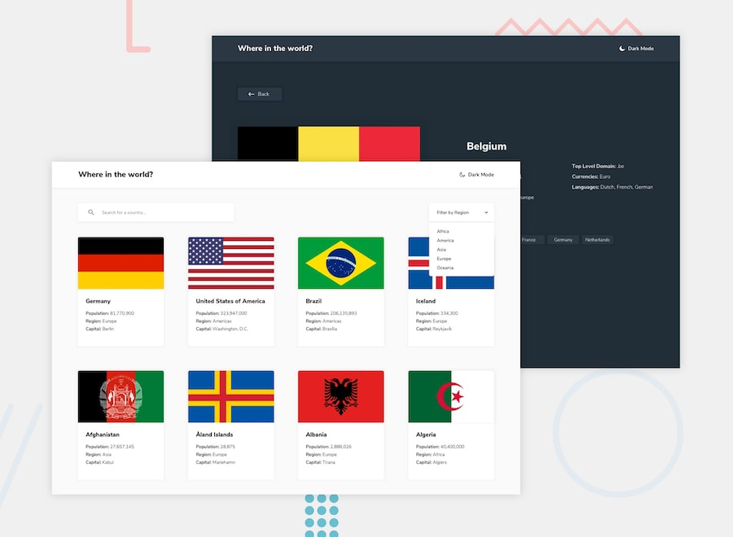

# Where in the World? — Country Explorer

A responsive country information website built with **HTML, CSS, and vanilla JavaScript**. Browse country information, search by name, filter by region, and explore neighbouring countries from a dedicated details page.

<p align="center">
  <a href="https://rest-countries-api-honey-upreti.netlify.app/">
    <strong>View Live Website</strong>
  </a>
</p>

## Preview



## Features

- **Browse countries:** View country cards with their flag, population, region, and capital.
- **Search countries:** Find countries by typing their name.
- **Filter by region:** Narrow the country list by Africa, Americas, Asia, Europe, or Oceania.
- **Country details:** Open a dedicated page to see more information, including native name, population, region, subregion, capital, top-level domain, currencies, and languages.
- **Neighbouring countries:** Navigate to bordering countries from a country's details page.
- **Dark and light themes:** Switch the color theme using the theme toggle.
- **Responsive layout:** The interface adapts to desktop and smaller screens.

## Built With

- **HTML5** — page structure
- **CSS3** — styling, layouts, hover effects, and responsive design
- **JavaScript (Vanilla)** — DOM manipulation, event handling, array methods, and dynamic rendering
- **Fetch API & JSON** — loading and processing the country dataset

## How It Works

The project loads country information from the included `data.json` file using JavaScript's `fetch()` method. The retrieved data is used to render the country cards and populate the detail pages.

Search and region filtering are handled with JavaScript array methods. Selecting a country opens a details page, where its border-country codes are matched against the dataset to create navigation links.

> **Data note:** This project uses the local `data.json` dataset supplied with the Frontend Mentor challenge. It does not currently make requests to the live REST Countries API.

## Run Locally

1. Clone this repository:

   ```bash
   git clone https://github.com/Honey-upreti/JavaScript-Projects.git
   ```

2. Open the project folder:

   ```bash
   cd JavaScript-Projects/rest-countries-api-with-color-theme-switcher-master
   ```

3. Start the project using a local development server. For example, use the **Live Server** extension in VS Code and open `index.html`.

   A local server is recommended because the app loads its data from `data.json`.

## Project Structure

```text
rest-countries-api-with-color-theme-switcher-master/
├── index.html       # Countries listing page
├── country.html     # Individual country details page
├── style.css        # Main styles and responsive layout
├── country.css      # Country details page styles
├── script.js        # Country listing, search, filtering, and theme logic
├── country.js       # Country details and border-country navigation
├── data.json        # Country dataset
└── preview.jpg      # Project preview image
```

## What I Practised

- Fetching and working with JSON data
- Using `filter()`, `find()`, and `forEach()`
- Dynamically creating and updating DOM elements
- Handling search input and select events
- Passing data between pages with URL query parameters
- Building responsive layouts with CSS Flexbox and media queries
- Implementing a dark/light theme toggle

## Acknowledgements

- Challenge and design inspiration: [Frontend Mentor — REST Countries API with Color Theme Switcher](https://www.frontendmentor.io/challenges/rest-countries-api-with-color-theme-switcher)
- Country dataset and flag image references: assets provided with the Frontend Mentor challenge

---

**Live Site:** https://rest-countries-api-honey-upreti.netlify.app/

**Repository:** https://github.com/Honey-upreti/JavaScript-Projects/tree/main/rest-countries-api-with-color-theme-switcher-master
